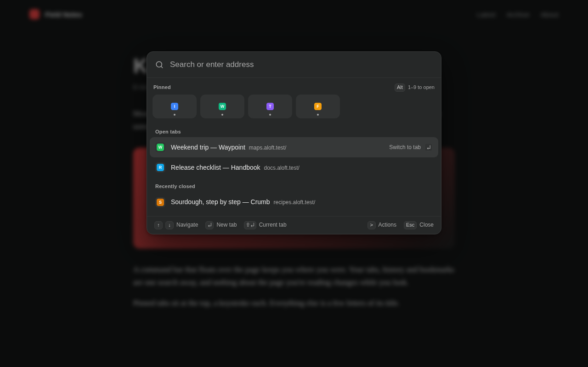
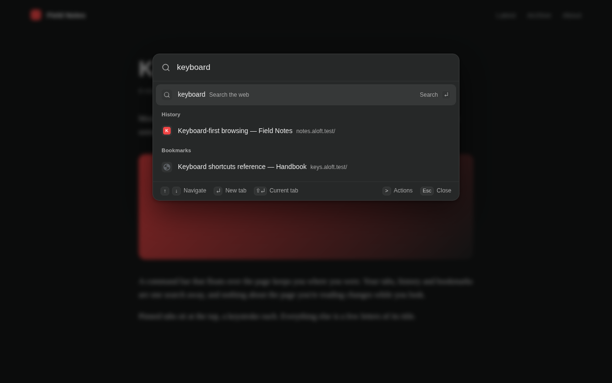
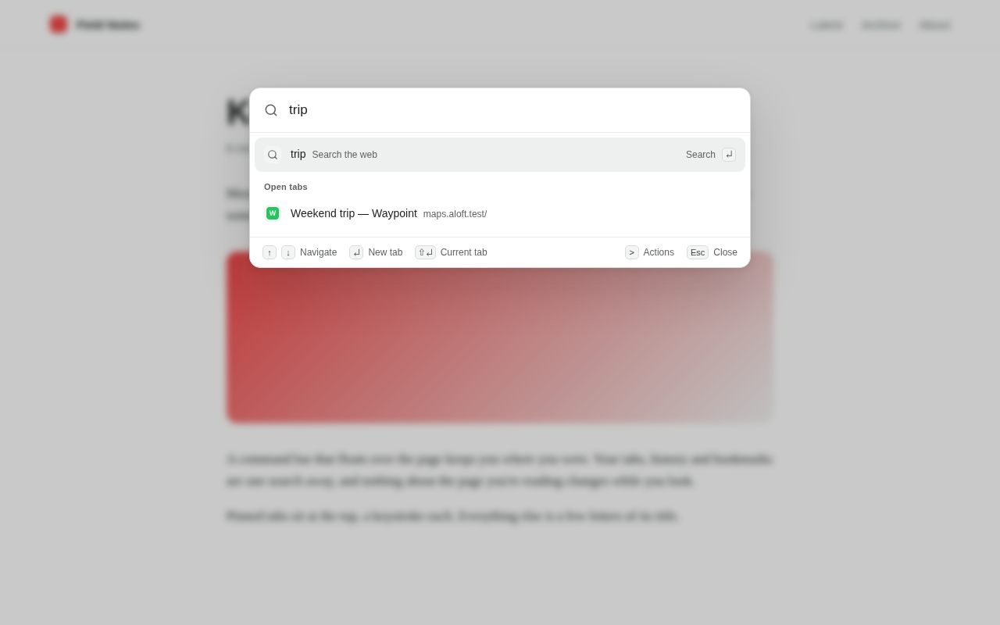

<div align="center">
    
    <h1>Aloft</h1>
    <p>
        A floating command bar for Helium and other Chromium browsers.
    </p>
    <p>
        <a href="https://github.com/tomszir/aloft-extension/actions/workflows/ci.yml"></a>
        <a href="https://github.com/tomszir/aloft-extension/releases/latest"></a>
        <a href="LICENSE"></a>
    </p>
</div>

<p align="center">
    
</p>

> [!NOTE]
> Aloft is in early development and not on the Chrome Web Store yet.
> Builds are attached to each [GitHub release](https://github.com/tomszir/aloft-extension/releases).

## What it does

Press <kbd>Ctrl</kbd>+<kbd>T</kbd> and, instead of a blank tab, a search bar floats over the page you're on. Type to find what you need, press <kbd>Enter</kbd>, and you're there.

- **One search for everything:** open tabs in every window, history, bookmarks and recently closed tabs, ranked together. Type an address to go straight to it, or anything else to search the web with your default engine.
- **Pinned tabs, one key away:** your pinned tabs sit at the top. <kbd>Alt</kbd>+<kbd>1</kbd> to <kbd>9</kbd> opens them.
- **Tab actions:** type <kbd>&gt;</kbd> to pin, duplicate, move to a new window, close other tabs or reopen a closed one.
- **Stays out of the way:** the page dims behind the bar instead of being replaced, and <kbd>Esc</kbd> puts you back exactly where you were.
- **Looks like your browser:** light and dark follow the browser, with built-in themes to choose from.

<table>
    <tr>
        <td></td>
        <td>" /></td>
    </tr>
    <tr>
        <td></td>
        <td></td>
    </tr>
</table>

## Install

Download `aloft-<version>-chrome.zip` from the [latest release](https://github.com/tomszir/aloft-extension/releases/latest) and unzip it. Then:

1. Open your browser's extensions page (`chrome://extensions`, or `helium://extensions` in Helium).
2. Turn on **Developer mode**.
3. Click **Load unpacked** and choose the unzipped folder.

On first run, Aloft asks for permission to draw on the sites you visit. That's what lets <kbd>Ctrl</kbd>+<kbd>T</kbd> open it over the current page. Without it, <kbd>Alt</kbd>+<kbd>Q</kbd> still works, and <kbd>Ctrl</kbd>+<kbd>T</kbd> shows Aloft as the new tab page instead.

## Shortcuts

| Keys                                                 | Does                                                                             |
| ---------------------------------------------------- | -------------------------------------------------------------------------------- |
| <kbd>Ctrl</kbd>+<kbd>T</kbd>                         | Open Aloft over the current page                                                 |
| <kbd>Alt</kbd>+<kbd>Q</kbd>                          | Open or close Aloft from any page (change it in the browser's shortcut settings) |
| <kbd>↑</kbd> <kbd>↓</kbd>                            | Move through results                                                             |
| <kbd>Enter</kbd> / <kbd>Shift</kbd>+<kbd>Enter</kbd> | Open in a new tab / in the current tab                                           |
| <kbd>Alt</kbd>+<kbd>1</kbd>–<kbd>9</kbd>             | Open a pinned tab                                                                |
| <kbd>&gt;</kbd>                                      | Tab actions                                                                      |
| <kbd>Esc</kbd>                                       | Close Aloft                                                                      |

## Privacy

Aloft makes no network requests and collects nothing. Your tabs, history and bookmarks are read locally to show results and never leave the browser.

The command bar is drawn inside an extension frame, so the page you're on can't read what Aloft shows. Each permission and why it's needed is listed in [docs/permissions.md](docs/permissions.md).

## Browser support

Aloft is built for [Helium](https://helium.computer) and is tested in Helium and Chromium. It uses no Helium-only features, so other Chromium browsers from version 121 should work too. In Helium, pinned tabs are shared across windows; elsewhere, Aloft shows the pinned tabs of the current window. Firefox support is planned.

## Development

```sh
mise run setup   # dependencies and git hooks
mise run dev     # a browser with Aloft loaded and live reload
```

See [CONTRIBUTING.md](CONTRIBUTING.md) for the workflow and [docs/architecture.md](docs/architecture.md) for how Aloft works.

## License

[GPL-3.0-only](LICENSE)
