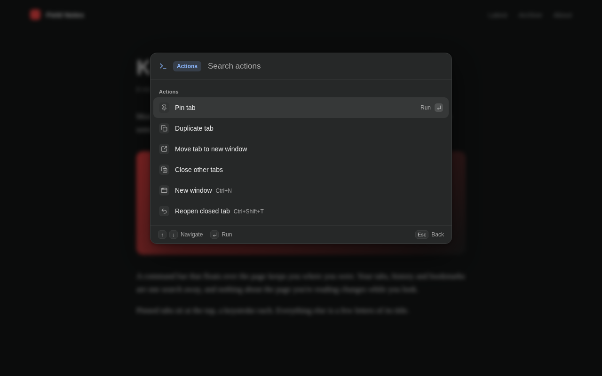
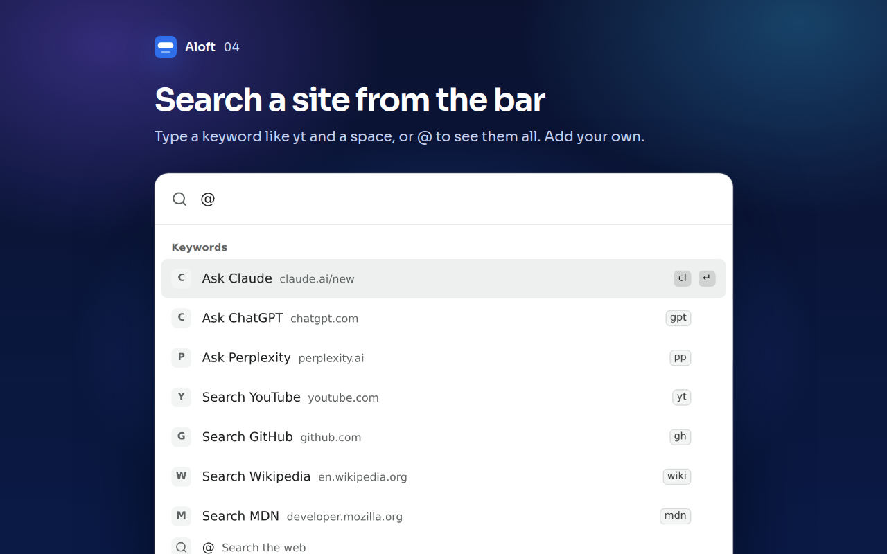
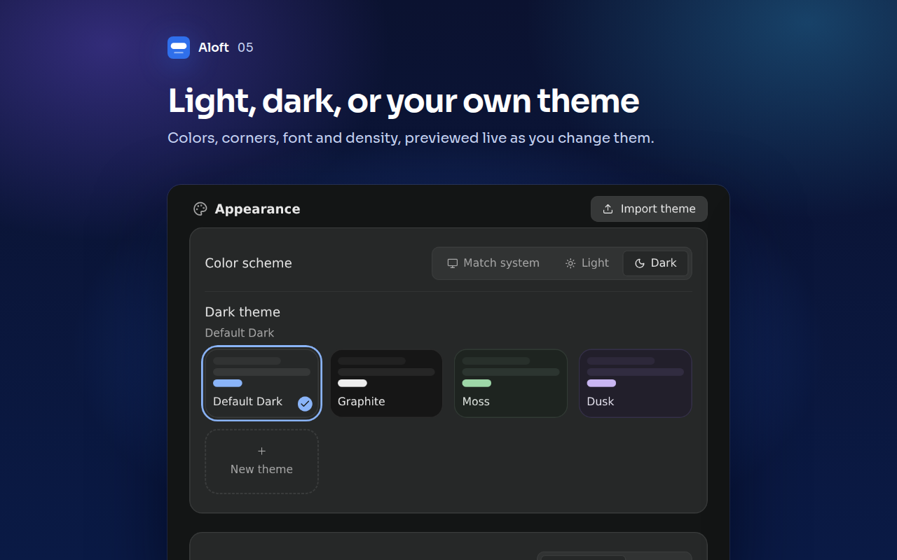

<div align="center">
    
    <h1>Aloft</h1>
    <p>
        A floating command bar for your tabs, history and bookmarks.
    </p>
    <p>
        <a href="https://github.com/tomszir/aloft-extension/actions/workflows/ci.yml"></a>
        <a href="https://chromewebstore.google.com/detail/neddelfbiddcgalggpghgbephhnebpjh"></a>
        <a href="https://addons.mozilla.org/firefox/addon/aloft/"></a>
        <a href="https://github.com/tomszir/aloft-extension/releases/latest"></a>
        <a href="LICENSE"></a>
    </p>
</div>

<p align="center">
    
</p>

## What it does

Press <kbd>Alt</kbd>+<kbd>Q</kbd>, or <kbd>Ctrl</kbd>+<kbd>T</kbd> if you give it to Aloft, and a search bar floats over the page you're on. Type to find what you need, press <kbd>Enter</kbd>, and you're there.

- **One search for everything:** open tabs in every window, history, bookmarks and recently closed tabs, ranked together, matched by initials and through typos, and learning which page you pick for what you type. Type an address to go straight to it, or anything else to search the web with your default engine.
- **Keywords:** type `yt`, `gh`, `cl` or `gpt` and Space to search YouTube or GitHub, or ask Claude or ChatGPT, right from the bar.
- **Scopes:** type `@tabs`, `@bookmarks` or `@history` and Space to search just one of them.
- **Pinned tabs, one key away:** your pinned tabs sit at the top. <kbd>Alt</kbd>+<kbd>1</kbd> to <kbd>9</kbd> opens them.
- **Actions:** type <kbd>&gt;</kbd> to pin, duplicate, move to a new window, close other tabs or reopen a closed one, or to open your browser's history, downloads, bookmarks, passwords, extensions or settings.
- **Stays out of the way:** the page dims behind the bar instead of being replaced, and <kbd>Esc</kbd> puts you back exactly where you were.
- **Looks like your browser, or like you want:** light and dark follow the browser, with built-in themes, or make your own (colors, corners, font and density) and share it as a file.

<table>
    <tr>
        <td></td>
        <td>" /></td>
    </tr>
    <tr>
        <td></td>
        <td></td>
    </tr>
</table>

## Install

- **Chrome, Helium and other Chromium browsers:** get it from the [Chrome Web Store](https://chromewebstore.google.com/detail/neddelfbiddcgalggpghgbephhnebpjh).
- **Firefox 140 and newer:** get it from [Firefox Add-ons](https://addons.mozilla.org/firefox/addon/aloft/).

See [what's new](CHANGELOG.md) in each version.

To run a build from a release instead, download it from the [latest release](https://github.com/tomszir/aloft-extension/releases/latest). In a Chromium browser, unzip `aloft-<version>-chrome.zip`, then:

1. Open your browser's extensions page (`chrome://extensions`, or `helium://extensions` in Helium).
2. Turn on **Developer mode**.
3. Click **Load unpacked** and choose the unzipped folder.

In Firefox, open `about:debugging`, choose **This Firefox**, click **Load Temporary Add-on** and pick `aloft-<version>-firefox.zip`. Firefox only keeps it until it restarts, since it isn't the signed copy from Firefox Add-ons.

Aloft opens with <kbd>Alt</kbd>+<kbd>Q</kbd> and needs no access to the sites you visit.

To open it with <kbd>Ctrl</kbd>+<kbd>T</kbd> instead of a blank tab, give it that key yourself: browsers don't let an extension take it. Open your browser's extension shortcuts (`chrome://extensions/shortcuts`, or in Firefox, `about:addons`, then the gear menu and **Manage Extension Shortcuts**; the first-run page has a button), find **Open Aloft (second shortcut, like Ctrl+T)** and press <kbd>Ctrl</kbd>+<kbd>T</kbd> in its box. <kbd>Alt</kbd>+<kbd>Q</kbd> keeps working, and <kbd>&gt;</kbd> **New tab** in Aloft opens an empty tab.

## Shortcuts

| Keys                                                 | Does                                                                             |
| ---------------------------------------------------- | -------------------------------------------------------------------------------- |
| <kbd>Alt</kbd>+<kbd>Q</kbd>                          | Open or close Aloft from any page (change it in the browser's shortcut settings) |
| <kbd>Ctrl</kbd>+<kbd>T</kbd>                         | The same, once you've given it to Aloft (see [Install](#install))                |
| <kbd>↑</kbd> <kbd>↓</kbd>                            | Move through results                                                             |
| <kbd>Enter</kbd> / <kbd>Shift</kbd>+<kbd>Enter</kbd> | Open in a new tab / in the current tab                                           |
| <kbd>Alt</kbd>+<kbd>1</kbd>–<kbd>9</kbd>             | Open a pinned tab                                                                |
| <kbd>Del</kbd>                                       | Close the selected open tab                                                      |
| <kbd>&gt;</kbd>                                      | Actions, and your browser's own pages                                            |
| <kbd>Esc</kbd>                                       | Close Aloft                                                                      |

## Privacy

Aloft makes no network requests and collects nothing. Your tabs, history and bookmarks are read locally to show results and never leave the browser.

The command bar is drawn inside an extension frame, so the page you're on can't read what Aloft shows. Each permission and why it's needed is listed in [docs/permissions.md](docs/permissions.md).

## Browser support

Aloft is built for [Helium](https://helium.computer) and is tested in Helium, Chromium and Firefox. It uses no Helium-only features, so other Chromium browsers from version 121 should work too. In Helium, pinned tabs are shared across windows; elsewhere, Aloft shows the pinned tabs of the current window.

In Firefox 140 and newer, Aloft does everything except open the browser's own pages (settings, add-ons and the like), which Firefox doesn't let extensions open, and its results show letter tiles instead of site icons. The full list is in [docs/browsers.md](docs/browsers.md).

## Development

```sh
mise run setup   # dependencies and git hooks
mise run dev     # a browser with Aloft loaded and live reload
```

See [CONTRIBUTING.md](CONTRIBUTING.md) for the workflow and [docs/architecture.md](docs/architecture.md) for how Aloft works.

## License

[GPL-3.0-only](LICENSE)
